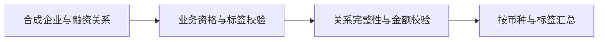

# 稳定币生态研究｜证据与关系表

从稳定币研究经历中提炼的独立方法演示：先确定企业业务证据，再检查融资关系完整性与缺失金额。

> 公开方法演示 / Public methodology demo。合成数据不代表原项目成果，具体实现由 AI 编程工具辅助完成。

## 功能

- 七类价值链标签可多选，广义 crypto 关键词不能替代纳入资格。
- 候选企业缺乏业务证据时进入待复核，不混入正式样本。
- 关系表拒绝重复和悬空 ID；金额缺失不补零；不同币种分开汇总。

## 本地运行

Python 3.11+。

```sh
python -m pip install -r requirements.txt
python analysis.py
python -m unittest discover -s tests -v
```

入口：`analysis.py`。不需要 API Key、数据库、网络服务或付费模型。

## 流程



## 验证

本地验证记录见 [VERIFICATION.md](VERIFICATION.md)。GitHub Actions 在 push 与 PR 时运行相同的离线测试；本地通过不代表远端 CI 已通过。

## 数据与局限

仅包含五家虚构企业与五条虚构融资记录。资格与标签由输入提供，程序不验证网站证据，也不调用分类模型。不是原团队研究的完整复现，不报告原数据库统计或分类准确率。

不分发 PitchBook 数据、真实公司关系明细、团队报告或导师批注。

## 许可与贡献

独立公开实现代码：MIT。合成样例随仓库发布，不向使用者授予任何第三方商业数据权利。没有捆绑原公司或团队源码。依赖与公开接口归因见 [NOTICE](NOTICE)。

[作品集](https://github.com/Willow-Tokoton-Hitorineko/research-portfolio) · [个人主页](https://github.com/Willow-Tokoton-Hitorineko)
